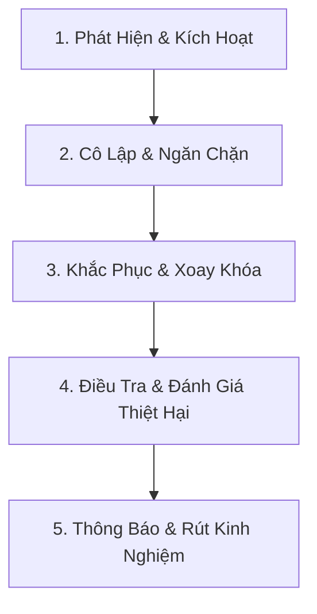

# Quy Trình Ứng Phó Sự Cố An Ninh Mạng & Lộ Lọt Dữ Liệu (Incident Response Plan)

Tài liệu này xác định các bước hành động bắt buộc của Ban Quản Trị và Đội ngũ Kỹ thuật ChillBanana khi phát hiện hoặc nghi ngờ có sự cố bảo mật thông tin, xâm nhập trái phép hoặc lộ lọt dữ liệu cá nhân khách hàng.

---

## 1. Phân Loại Cấp Độ Sự Cố (Severity Levels)

| Cấp độ | Định nghĩa | Ví dụ | Thời gian phản ứng |
| :--- | :--- | :--- | :--- |
| **SEV-1 (Nghiêm trọng)** | Lộ cơ sở dữ liệu sản xuất, khóa bí mật master hoặc dữ liệu cá nhân hàng loạt (> 50 khách). | Rò rỉ `DATABASE_URL`, lộ file dump khách hàng. | **Dưới 15 phút** |
| **SEV-2 (Trung bình)** | Lỗi vượt quyền (privilege escalation), lộ dữ liệu đơn lẻ của 1-2 khách, hoặc API Key dịch vụ bị rò rỉ. | Lộ API Key Gemini, xem trộm đơn hàng khác. | **Dưới 1 giờ** |
| **SEV-3 (Thấp)** | Tấn công dò quét tự động (Brute force), spam rate-limit, lỗi lặt vặt không làm lộ dữ liệu. | Dò quét URL `/admin`, thử password ngẫu nhiên. | **Trong ngày làm việc** |

---

## 2. Quy Trình 5 Bước Ứng Phó Sự Cố

### Bước 1: Phát Hiện & Kích Hoạt Báo Động
- Người phát hiện (Agent, Developer, Khách hàng báo) lập tức thông báo tới Super Admin qua kênh khẩn cấp.
- Đóng băng nhánh mã nguồn, tạm dừng các luồng triển khai tự động.

### Bước 2: Cô Lập & Ngăn Chặn Thiệt Hại (Containment)
- **Nếu rò rỉ khóa kết nối DB / Secret:** Xoay ngay lập tức trên Bảng điều khiển Neon.tech và Vercel Environment Variables:
  - Đổi mật khẩu tài khoản PostgreSQL trên Neon.
  - Tạo mới `ADMIN_SESSION_SECRET` và `CUSTOMER_SESSION_SECRET` (`openssl rand -hex 32`). Toàn bộ phiên đang đăng nhập sẽ bị vô hiệu hóa cưỡng chế.
  - Thu hồi và tạo mới `GEMINI_API_KEY`, khóa VNPAY.
- **Nếu bị tấn công qua một Endpoint:**
  - Chặn ngay IP hoặc dải IP tấn công tại Cloudflare / Vercel Firewall.
  - Tạm thời chuyển Endpoint bị ảnh hưởng sang chế độ bảo trì (`503 Service Unavailable`).

### Bước 3: Khắc Phục Lỗ Hổng & Kiểm Thử
- Sửa lỗi trong môi trường sandbox/test độc lập.
- Viết test tái hiện sự cố và kiểm chứng lỗi đã được vá triệt để.
- Chạy toàn bộ bộ test kiểm kê trước khi triển khai bản vá lên môi trường thật.

### Bước 4: Điều Tra Phạm Vi Ảnh Hưởng
- Rà soát bảng `AuditLog` và access logs máy chủ:
  - Xác định chính xác các bản ghi nào đã bị đọc hoặc tải về.
  - Liệt kê danh sách các khách hàng bị ảnh hưởng trực tiếp (Họ tên, SĐT, Email).

### Bước 5: Thông Báo & Khắc Phục Hậu Quả
- **Thông báo khách hàng:** Gửi email thông báo minh bạch trong vòng 72 giờ:
  - Bản chất của sự cố và dữ liệu bị ảnh hưởng.
  - Các biện pháp ChillBanana đã thực hiện để khắc phục.
  - Khuyến cáo khách hàng đổi mật khẩu tài khoản.
- **Báo cáo cơ quan thẩm quyền:** Chuẩn bị hồ sơ pháp lý theo Nghị định bảo vệ dữ liệu cá nhân (Nghị định 13/2023/NĐ-CP).
- **Họp rút kinh nghiệm (Post-mortem):** Phân tích nguyên nhân gốc rễ và bổ sung rào chắn vào `AGENTS.md`.

