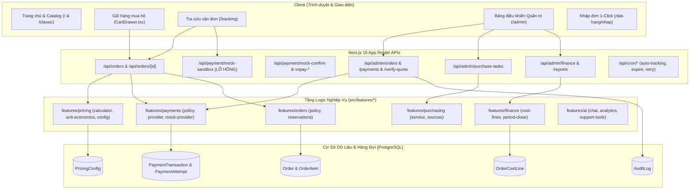

# Báo Cáo Rà Soát Kỹ Thuật Chỉ Đọc (Technical Audit) — Pha 1

- **Ngày thực hiện:** 17/11/2026
- **Kỹ sư trưởng:** ChillBanana Agent
- **Phương pháp rà soát:** Đọc mã nguồn, đối chiếu tài liệu SOP/schema, grep toàn bộ repo, kiểm chứng bằng các test cases chạy thật trên TypeScript & Vitest. Tuyệt đối không suy đoán cảm tính, không tin mù báo cáo chưa kiểm chứng.
- **Cam kết Pha 1:** Không can thiệp, không chỉnh sửa bất kỳ dòng mã nguồn nào trong pha này.

---

## 1. Bản Đồ Kiến Trúc Hệ Thống (Architecture Map)

---

## 2. Bản Đồ Luồng Nghiệp Vụ Cốt Lõi

### 2.1. Luồng Trạng Thái Đơn Hàng (Order Lifecycle)

```mermaid
stateDiagram-v2
    [*] --> PENDING_DEPOSIT: Khách tạo đơn (Catalog hoặc Dán link)
    
    note right of PENDING_DEPOSIT
      Nếu hàng dán link: Chờ Admin duyệt giá (isPriceVerified=true)
      Giữ hàng Catalog: 30 phút; Hỗn hợp: 24h
    end note

    PENDING_DEPOSIT --> PURCHASING_JP: Đã cọc (DEPOSITED_50 / DEPOSITED_70 / PAID_100) (Kho JP)
    PENDING_DEPOSIT --> WAREHOUSE_VN: Đã cọc (Kho VN sẵn có)
    
    PURCHASING_JP --> PURCHASED_JP: Nhân viên JP đặt mua trên sàn
    PURCHASED_JP --> WAREHOUSE_JP: Hàng về kho Tokyo (Cân đo, kiểm đếm)
    WAREHOUSE_JP --> IN_TRANSIT_AIR: Đóng kiện, bay Narita -> Nội Bài/Tân Sơn Nhất
    IN_TRANSIT_AIR --> WAREHOUSE_VN: Nhập kho Việt Nam (Thông quan)
    
    note right of WAREHOUSE_VN
      YÊU CẦU: Thu đủ 100% (PAID_100) trước khi giao nội địa
      (Trừ trường hợp Admin dùng quyền Override có AuditLog)
    end note

    WAREHOUSE_VN --> LOCAL_DELIVERY: Giao hàng chặng cuối (GHTK/GHN/ViettelPost)
    LOCAL_DELIVERY --> COMPLETED: Giao thành công & Đối soát COD
    
    PENDING_DEPOSIT --> CANCELLED: Khách hủy / Hết hạn giữ hàng
    PURCHASING_JP --> CANCELLED: Hết hàng trên sàn Nhật (Hoàn cọc)
    CANCELLED --> REFUNDED: Tạo PaymentTransaction REVERSAL
```

### 2.2. Luồng Tiền & Thanh Toán (Cashflow & Payment Settlement)

- **Cọc Đợt 1:** Thu khi tạo đơn để chốt giữ chỗ và đi mua hàng bên Nhật.
- **Tất Toán Đợt 2:** Thu khi hàng cập kho Việt Nam (`WAREHOUSE_VN`) bao gồm cước bay quốc tế thực tế + tiền hàng còn lại.
- **Kênh thanh toán:**
  1. *VietQR (Chuyển khoản thủ công):* Khách quét QR, admin đối soát qua ngân hàng và xác nhận trong Admin Portal.
  2. *VNPAY Sandbox (Cổng online):* Khách chuyển hướng qua cổng VNPAY, kết quả ghi nhận qua IPN.
  3. *Mock Sandbox / Mock Confirm:* Dành riêng cho kịch bản chạy thử (Demo/Test).
- **Nguyên tắc tài chính bất biến:**
  - Tiền luôn là số nguyên VND (`Math.round`).
  - Không bao giờ xóa cứng bản ghi thanh toán (`PaymentTransaction`); hoàn tiền hoặc đảo giao dịch bắt buộc dùng `kind = "REVERSAL"`.

### 2.3. Luồng Phân Quyền (RBAC Flow)

- **Khách hàng:** Xác thực qua cookie JWT (`auth-token`), khách vãng lai dùng cookie bảo mật truy cập vận đơn (`ORDER_ACCESS_COOKIE_NAME`).
- **Quản trị viên:** Xác thực qua session admin cookie (`admin-session-token`), đối chiếu trực tiếp bản ghi `AdminUser` trong PostgreSQL qua hàm `requireAdmin(req, { roles: [...] })`.

---

## 3. Kiểm Chứng 6 Điểm Nêu Trong Yêu Cầu Của Chủ Dự Án

| Điểm kiểm chứng | Hiện trạng kiểm chứng trong mã nguồn | Đánh giá | Bằng chứng mã nguồn |
| :--- | :--- | :---: | :--- |
| **1. Mock Sandbox cho chủ đơn tự đánh dấu đã thanh toán** | Khách hàng sở hữu đơn hàng gửi request `POST /api/payment/mock-sandbox` với `{ action: "success" }` thì đơn hàng tự động chuyển sang `PURCHASING_JP` và ghi nhận `paymentStatus` thành công. Tuyệt đối không có rào chắn môi trường `APP_ENV !== "production"`. | **XÁC MINH: ĐÚNG 100% (NGHIÊM TRỌNG)** | `src/app/api/payment/mock-sandbox/route.ts:36-54` & `78-142`. Bất kỳ ai cũng có thể giả mạo thanh toán đơn hàng thật. |
| **2. mock-confirm với PAYMENT_AUTO_CONFIRM_ORDER=true** | Endpoint `mock-confirm` cho phép nhận `outcome: "success"` trực tiếp từ browser. Nếu cờ `PAYMENT_AUTO_CONFIRM_ORDER=true`, hệ thống tự động chốt đơn thành công. Ngoài ra `vnpay-return` cũng tự động chốt tiền từ request GET front-channel của browser. | **XÁC MINH: ĐÚNG 100% (NGHIÊM TRỌNG)** | `src/lib/mock-payment.ts:11,42` & `src/app/api/payment/vnpay-return/route.ts:27-34`. |
| **3. Cấu hình VietQR mặc định tài khoản mẫu 0901234567** | Biến `NEXT_PUBLIC_BANK_ACCOUNT` có giá trị fallback cứng là `"0901234567"`, `NEXT_PUBLIC_BANK_BIN` là `"970422"` (MB Bank), chủ sở hữu `"CHILLBANANA VIETNAM"`. | **XÁC MINH: ĐÚNG 100% (NGHIÊM TRỌNG)** | `src/app/tracking/page.tsx:78` & `src/components/NeoDaylightCosmos.tsx:45`. Quên cấu hình env sẽ khiến khách chuyển tiền vào số tài khoản ảo. |
| **4. Trạng thái DEPOSITED_70 bị bỏ sót ở nhiều nơi** | Toàn bộ hệ thống gần như chỉ hỗ trợ `DEPOSITED_50` và `PAID_100`. Nếu đơn hàng rơi vào mức cọc 70%, đơn hàng bị kẹt vĩnh viễn: admin không thể chuyển bước mua hàng, hàng đợi mua hàng bỏ sót, báo cáo bỏ sót. | **XÁC MINH: ĐÚNG 100% (NGHIÊM TRỌNG)** | `src/app/api/orders/[id]/route.ts:504` (chặn chuyển `PURCHASING_JP`), `src/app/api/admin/purchase-tasks/orders/route.ts:18` (bỏ sót), `src/types/index.ts:169`. |
| **5. Giao diện báo cọc 50% trong khi server thu 100% hoặc 70%** | Giao diện giỏ hàng (`CartDrawer.tsx`) chỉ hiển thị 2 nút chọn: "Cọc 50%" và "Thanh toán 100%". Khách chọn cọc 50%, nhưng server áp dụng chính sách cọc phân tầng: đơn < 1M thu 100%, đơn 1M-10M thu 70%. | **XÁC MINH: ĐÚNG 100% (CAO)** | `src/components/CartDrawer.tsx:650-699` đối chiếu `src/app/api/orders/route.ts:467-472` và `src/features/payments/policy.ts:62-99`. Khách đặt xong bị tính cọc 70% hoặc 100% gây tranh cãi. |
| **6. Phí dịch vụ 4% làm lỗ đơn nhỏ** | Phí dịch vụ 4% cho đơn 3.850 JPY (~654.500 đ) thu về 26.180 đ, trong khi chi phí thực tế (kho Tokyo 51.000 đ, ship nội địa VN 35.000 đ, cổng thanh toán...) là 163.959 đ. Lỗ ròng **-45.279 đ** / đơn. Đã kiểm chứng chạy test unit thật! | **XÁC MINH: ĐÚNG 100% (CAO)** | `src/features/pricing/unit-economics.ts:8-146`, `tests/unit/unit-economics.test.ts:23-51`. Càng nhiều đơn nhỏ công ty càng lỗ nặng. |

---

## 4. Danh Sách Lỗi & Rủi Ro Chi Tiết Theo Mức Độ

### 🔴 MỨC ĐỘ 1: NGHIÊM TRỌNG (CRITICAL)
*Ảnh hưởng trực tiếp đến an toàn tiền tệ, dữ liệu và có thể bị khai thác để trục lợi hoặc làm sập luồng vận hành chính.*

1. **Lỗ hổng trục lợi thanh toán tại `mock-sandbox`:**
   - **Vị trí:** [src/app/api/payment/mock-sandbox/route.ts](file:///d:/BAITAP/ChillBanana-main/src/app/api/payment/mock-sandbox/route.ts#L36-L142)
   - **Chi tiết:** Route nhận request POST `{ action: "success" }` từ khách hàng sở hữu đơn hàng (qua cookie khách hoặc cookie guest), sau đó trực tiếp cập nhật `paymentStatus: "DEPOSITED_50/100"` và chuyển trạng thái sang `PURCHASING_JP` mà không có bất kỳ điều kiện khóa môi trường nào (`APP_ENV !== "production"` hay `isDemoMode()`).
   - **Cách tái hiện:** Đặt một đơn hàng thật -> Vào trang `/tracking` -> Mở console gọi fetch POST tới `/api/payment/mock-sandbox` với `{ orderCode: "...", action: "success" }` -> Đơn hàng chuyển sang trạng thái đã thanh toán cọc thành công mà không hề mất 1 đồng nào.

2. **Chốt giao dịch trên luồng trình duyệt (Front-channel settlement):**
   - **Vị trí:** [src/app/api/payment/vnpay-return/route.ts](file:///d:/BAITAP/ChillBanana-main/src/app/api/payment/vnpay-return/route.ts#L27-L34) & [src/lib/mock-payment.ts](file:///d:/BAITAP/ChillBanana-main/src/lib/mock-payment.ts#L42-L60)
   - **Chi tiết:** `vnpay-return` là route nhận GET request khi khách quay lại trình duyệt từ VNPAY. Route này gọi `confirmVnpayPayment` để chốt tiền nếu `PAYMENT_AUTO_CONFIRM_ORDER=true`. Theo chuẩn an toàn thanh toán ngân hàng, front-channel chỉ được dùng để thông báo cho khách, việc chốt tiền và đổi trạng thái đơn bắt buộc phải do IPN (Back-channel webhook) đảm nhiệm. Tương tự, `mock-confirm` cho phép browser gửi outcome trực tiếp để tự chốt đơn.
   - **Cách tái hiện:** Gọi GET tới `/api/payment/vnpay-return` với các tham số query hợp lệ (hoặc replay URL) khi cờ tự động bật.

3. **Bế tắc vận hành hoàn toàn đối với đơn cọc 70% (`DEPOSITED_70`):**
   - **Vị trí:**
     + [src/app/api/orders/[id]/route.ts](file:///d:/BAITAP/ChillBanana-main/src/app/api/orders/[id]/route.ts#L504): `if (existingOrder.paymentStatus !== "DEPOSITED_50" && existingOrder.paymentStatus !== "PAID_100") return 409;` -> Chặn không cho admin chuyển sang `PURCHASING_JP`.
     + [src/app/api/admin/purchase-tasks/orders/route.ts](file:///d:/BAITAP/ChillBanana-main/src/app/api/admin/purchase-tasks/orders/route.ts#L18): Chỉ query `DEPOSITED_50` và `PAID_100`, bỏ rơi toàn bộ đơn 70%.
     + [src/features/purchasing/service.ts](file:///d:/BAITAP/ChillBanana-main/src/features/purchasing/service.ts#L39): Từ chối tạo tác vụ mua hàng.
     + [src/app/api/orders/[id]/route.ts](file:///d:/BAITAP/ChillBanana-main/src/app/api/orders/[id]/route.ts#L382): Khi rollback thì ép gán ngược về `DEPOSITED_50`.
   - **Cách tái hiện:** Tạo đơn hàng từ 1.000.000 đ đến 10.000.000 đ (hệ thống tự tính cọc 70%) -> Thanh toán cọc 70% -> Vào admin bấm chuyển sang "Đang mua hàng Nhật" -> Nhận thông báo lỗi HTTP 409 "Cần xác nhận đã nhận tiền cọc trước khi chuyển đơn sang bước mua hàng". Đơn hàng kẹt vĩnh viễn.

4. **Thông tin tài khoản VietQR hardcode mẫu `0901234567`:**
   - **Vị trí:** [src/app/tracking/page.tsx](file:///d:/BAITAP/ChillBanana-main/src/app/tracking/page.tsx#L78) & [src/components/NeoDaylightCosmos.tsx](file:///d:/BAITAP/ChillBanana-main/src/components/NeoDaylightCosmos.tsx#L45)
   - **Chi tiết:** Giá trị fallback cứng trực tiếp trong file giao diện. Nếu biến môi trường `NEXT_PUBLIC_BANK_ACCOUNT` không được nạp ở production, hệ thống âm thầm render mã QR chuyển tiền vào số điện thoại mẫu `0901234567`.
   - **Cách tái hiện:** Xóa biến môi trường `NEXT_PUBLIC_BANK_ACCOUNT` -> Mở trang tracking đơn hàng -> Mã VietQR hiển thị STK 0901234567 (MB Bank).

---

### 🟠 MỨC ĐỘ 2: CAO (HIGH)
*Ảnh hưởng lớn đến trải nghiệm khách hàng, hiệu quả kinh doanh hoặc rò rỉ quyền hạn nội bộ.*

5. **Mâu thuẫn giữa mức cọc trên giao diện và tính toán của máy chủ:**
   - **Vị trí:** [src/components/CartDrawer.tsx](file:///d:/BAITAP/ChillBanana-main/src/components/CartDrawer.tsx#L650-L699) đối chiếu [src/app/api/orders/route.ts](file:///d:/BAITAP/ChillBanana-main/src/app/api/orders/route.ts#L467-L472)
   - **Chi tiết:** Giao diện chào mời khách chọn "Đặt cọc 50%" và tính tiền cọc bằng 50% tiền hàng. Khách nhấn Đặt hàng, máy chủ chạy `calculateDepositV2` ép đơn hàng < 1M thành cọc 100%, đơn 1M-10M thành cọc 70%. Khách mở đơn thấy số tiền phải trả khác hoàn toàn với lúc chốt giỏ.
   - **Cách tái hiện:** Thêm sản phẩm trị giá 2.000.000 đ vào giỏ -> Chọn nút "Đặt cọc 50%" (hiển thị 1.000.000 đ) -> Bấm đặt hàng -> Mở trang đơn hàng thấy tiền cọc yêu cầu là 1.400.000 đ (70%).

6. **Kinh tế đơn vị âm (Đơn hàng nhỏ chắc chắn lỗ):**
   - **Vị trí:** [src/features/pricing/unit-economics.ts](file:///d:/BAITAP/ChillBanana-main/src/features/pricing/unit-economics.ts#L20-L146)
   - **Chi tiết:** Phí dịch vụ mua hộ đang để mặc định 4% và phí dịch vụ tối thiểu chỉ 20.000 đ. Với các đơn hàng dưới 1.000.000 đ, công ty phải bù lỗ chi phí kho Tokyo (300 JPY ~ 51.000 đ) và ship nội địa VN (35.000 đ). Đơn mẫu 3.850 JPY âm -45.279 đ, đơn 2.000 JPY âm -56.280 đ.

7. **Lỗ hổng kiểm soát quyền Admin (Thiếu tham số roles):**
   - **Vị trí:** Hơn 15 endpoints trong `src/app/api/admin/` chỉ gọi `requireAdmin(req)` mà không truyền mảng `roles: [...]`.
   - **Chi tiết:** Tiêu biểu là [src/app/api/admin/orders/[id]/payments/route.ts](file:///d:/BAITAP/ChillBanana-main/src/app/api/admin/orders/[id]/payments/route.ts#L11) (xác nhận chuyển khoản ngân hàng) và [src/app/api/admin/orders/[id]/costs/route.ts](file:///d:/BAITAP/ChillBanana-main/src/app/api/admin/orders/[id]/costs/route.ts) (ghi nhận chi phí) cho phép mọi tài khoản admin (kể cả nhân viên vận hành thông thường `OPERATOR`) tự ý xác nhận tiền vào hệ thống mà không cần vai trò `SUPER_ADMIN` hay `ACCOUNTANT`.

8. **Mâu thuẫn vai trò RBAC giữa Schema DB, Mã nguồn và Tài liệu:**
   - **Vị trí:** [prisma/schema.prisma](file:///d:/BAITAP/ChillBanana-main/prisma/schema.prisma#L261) (chỉ có `SUPER_ADMIN`, `OPERATOR`), [src/app/api/admin/finance/close-period/route.ts](file:///d:/BAITAP/ChillBanana-main/src/app/api/admin/finance/close-period/route.ts#L12) (kiểm tra `ACCOUNTANT`), [docs/RBAC.md](file:///d:/BAITAP/ChillBanana-main/docs/RBAC.md) (liệt kê 5 vai trò).

---

### 🟡 MỨC ĐỘ 3: TRUNG BÌNH (MEDIUM)
*Lệch pha logic, dữ liệu không nhất quán nhưng có thể khắc phục trong quy trình vận hành.*

9. **Lệch trạng thái đơn hàng khi xác nhận thanh toán VietQR thủ công:**
   - **Vị trí:** [src/app/api/admin/orders/[id]/payments/route.ts](file:///d:/BAITAP/ChillBanana-main/src/app/api/admin/orders/[id]/payments/route.ts#L54)
   - **Chi tiết:** Admin bấm xác nhận tiền cọc thành công, `paymentStatus` được cập nhật, nhưng `status` của đơn hàng vẫn giữ nguyên `PENDING_DEPOSIT` (thay vì tự chuyển sang `PURCHASING_JP` như các kênh thanh toán khác). Nhân viên phải thao tác thủ công thêm một bước để đổi trạng thái.

10. **Thông tin ngân hàng VietQR phân tán, đọc trực tiếp từ env phía Client:**
    - **Vị trí:** `src/app/tracking/page.tsx` và `src/components/NeoDaylightCosmos.tsx`
    - **Chi tiết:** Thay vì lấy cấu hình ngân hàng tập trung từ máy chủ (`PricingConfig` hoặc API), giao diện lại đọc trực tiếp các biến `process.env.NEXT_PUBLIC_BANK_*`, gây phân tán và khó quản lý tập trung.

---

### 🟢 MỨC ĐỘ 4: THẤP (LOW)
*Code style, lint, warning và tối ưu hóa nhỏ.*

11. **Lỗi `next lint` do dùng thẻ `<a>` thay vì `<Link />`:**
    - **Vị trí:** [src/app/dat-hang/nhap/page.tsx](file:///d:/BAITAP/ChillBanana-main/src/app/dat-hang/nhap/page.tsx#L94)
    - **Chi tiết:** Sử dụng thẻ `<a>` chuyển hướng trang chủ gây lỗi `no-html-link-for-pages` khi chạy lệnh lint.

12. **Cảnh báo `any` và biến không dùng:**
    - Hơn 30 cảnh báo `@typescript-eslint/no-explicit-any` tại các file admin components và AI tools.

---

## 5. Kết Luận & Chuyển Giao Cho Pha 2

Hệ thống ChillBanana sở hữu bộ khung xử lý logic thuần tương đối hoàn chỉnh (399 unit tests đã pass), tuy nhiên đang chứa **4 lỗ hổng nghiêm trọng** liên quan đến an toàn thanh toán và kẹt luồng trạng thái cọc 70%, cùng với sự mất cân bằng về kinh tế đơn vị ở các đơn hàng nhỏ. 

Báo cáo này là cơ sở vững chắc để bước sang **Pha 2: Lập kế hoạch kiến trúc với 3 phương án và đề xuất giải pháp tối ưu**.
